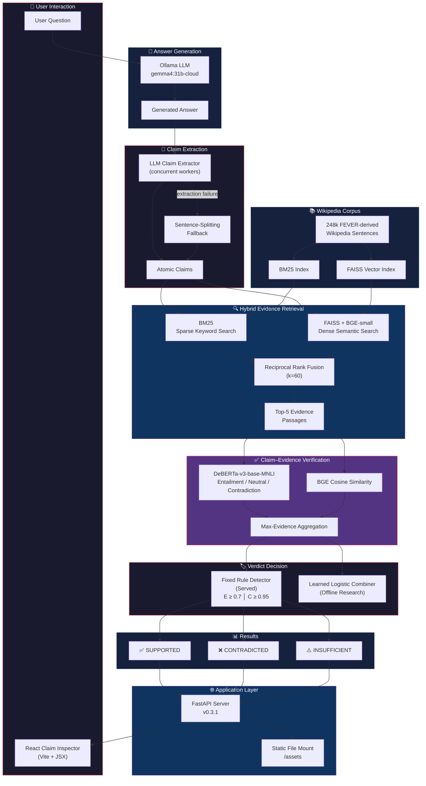

# 01 — System Overview

High-level architecture of the Claim-Level Hallucination Detection System.
The diagram shows every major component from user input to final verdict.

---

## End-to-End Architecture

---

## Component Summary

| Component | Technology | Role |
|-----------|-----------|------|
| Answer Generation | Ollama + gemma4:31b-cloud | Generate answers to user questions |
| Claim Extraction | LLM prompt + sentence fallback | Decompose answers into atomic factual propositions |
| BM25 Retrieval | rank-bm25 | Sparse keyword matching against Wikipedia corpus |
| Dense Retrieval | FAISS + BGE-small-en-v1.5 | Semantic vector search for evidence |
| Reciprocal Rank Fusion | Custom RRF (k=60) | Merge BM25 + dense candidate lists |
| NLI Verification | DeBERTa-v3-base-MNLI | Classify claim–evidence pairs as entail/neutral/contradict |
| Similarity | BGE cosine similarity | Secondary semantic similarity signal |
| Fixed Rule | Threshold detector | Deterministic served verdict (E ≥ 0.7, C ≥ 0.95) |
| Learned Combiner | Logistic regression | Offline 30–45 feature research model |
| API | FastAPI | REST endpoints: `/detect`, `/claims`, `/retrieve`, `/verify` |
| UI | React + Vite | Interactive claim inspector with evidence display |
