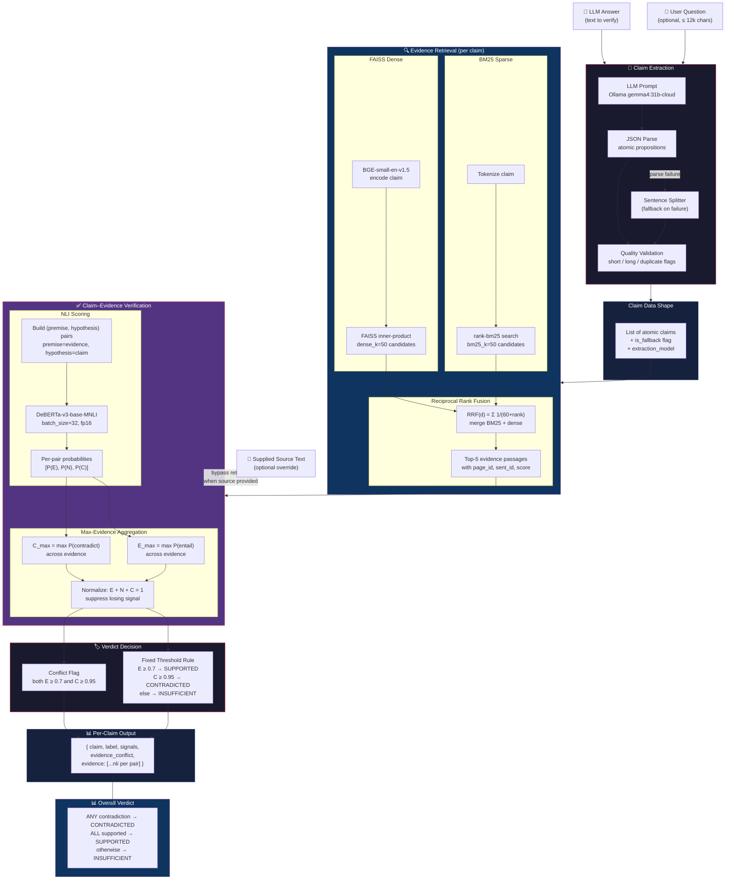

# 02 — Pipeline Flow

Detailed claim-level detection pipeline showing every data transformation
from raw user input to the final per-claim verdict. Solid arrows are the
served path; dashed arrows are fallback or offline paths.

---

## Claim-Level Detection Pipeline

---

## Data Transformation Summary

| Stage | Input | Output | Shape |
|-------|-------|--------|-------|
| Claim Extraction | Answer text (+ question) | List of atomic claims | `[str, ...]` |
| Evidence Retrieval | One claim | Top-5 passages with metadata | `[{text, page_id, sent_id, score}, ...]` |
| NLI Scoring | (claim, evidence) pairs | Probability triples | `[[P(E), P(N), P(C)], ...]` per evidence |
| Aggregation | Per-evidence probabilities | Single [E, N, C] vector | `[float, float, float]` |
| Decision | Aggregated probabilities | 3-way label + conflict flag | `{label, signals, evidence_conflict}` |
| Overall | All per-claim labels | Single answer-level label | `SUPPORTED / CONTRADICTED / INSUFFICIENT` |
