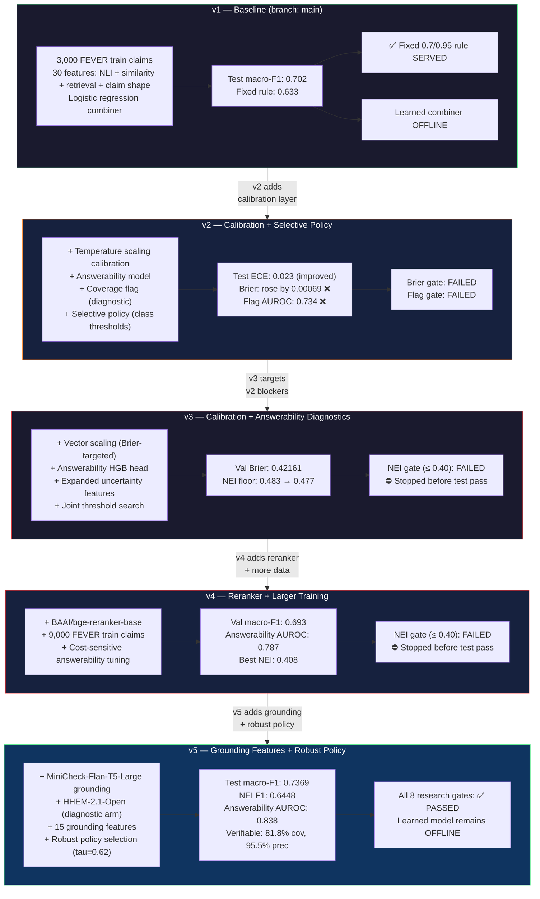
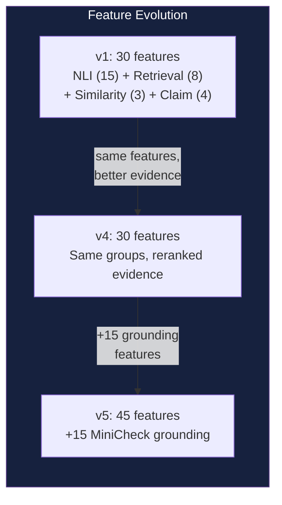

# 03 — Version Evolution

Research lineage from v1 baseline through v5 grounding. Each version is a
self-contained research checkpoint; the served path remains the v1 fixed rule.

---

## Research Version Timeline

---

## Cumulative Feature Stack

---

## Gate Summary

| Version | Test Pass | Key Gate | Outcome | Promotion |
|---------|-----------|----------|---------|-----------|
| v1 | ✅ Spent | Macro-F1 vs fixed rule | 0.702 vs 0.633 ✅ | Learned stays offline |
| v2 | ✅ Spent | Brier ≤ baseline, Flag AUROC ≥ 0.75 | Brier +0.00069 ❌, AUROC 0.734 ❌ | No promotion |
| v3 | ⛔ Not spent | NEI coverage ≤ 0.40 | NEI floor 0.477 ❌ | Stopped |
| v4 | ⛔ Not spent | NEI coverage ≤ 0.40 | NEI floor 0.408 ❌ | Stopped |
| v5 | ✅ Spent | 8 research gates | All passed ✅ | Learned still offline |

## Serving Path (All Versions)

> The served path has remained identical across all five versions.
> Every version's learned model is an offline research result only.
