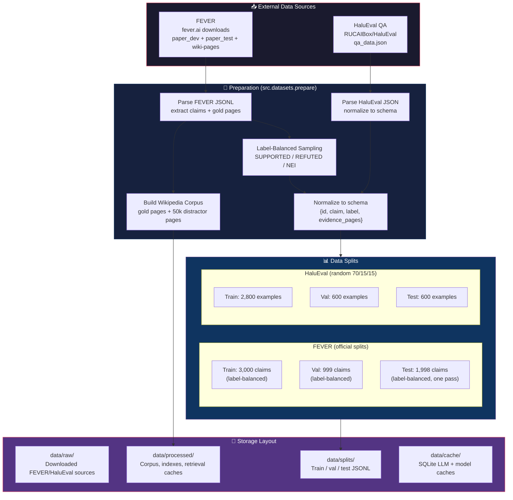
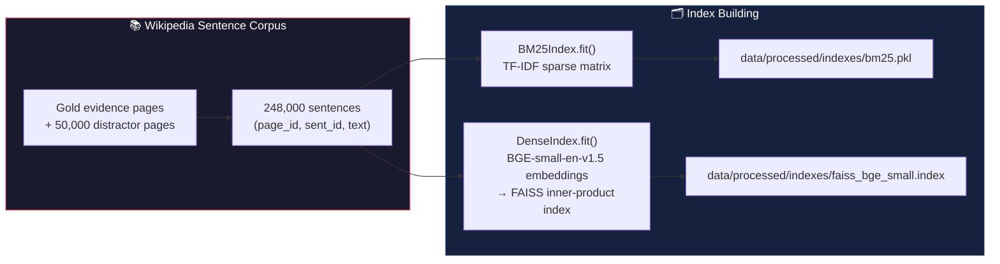
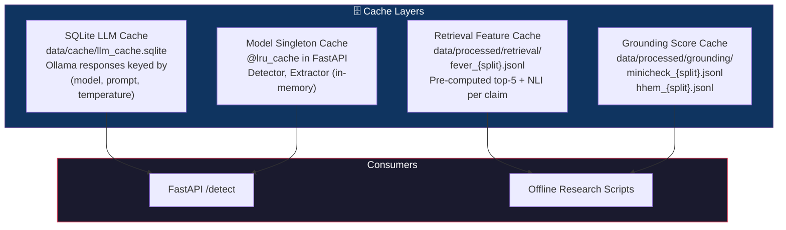
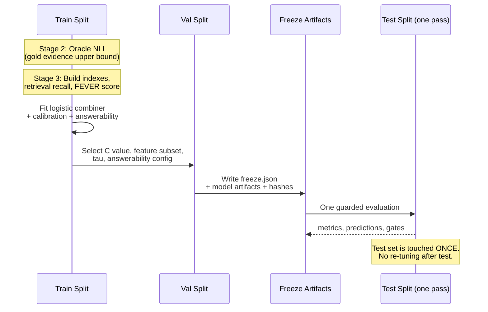

# 04 — Data Flow

Dataset preparation, splits, index construction, caching, and evaluation protocol.

---

## Dataset Preparation Pipeline

---

## Corpus and Index Construction

---

## Caching Architecture

---

## Evaluation Protocol

---

## Data Shape Reference

| Artifact | Format | Key Fields | Size |
|----------|--------|------------|------|
| FEVER split | JSONL | `id, claim, label, evidence_pages` | 3k / 1k / 2k claims |
| HaluEval split | JSONL | `id, question, answer, label` | 2.8k / 600 / 600 |
| Wikipedia corpus | In-memory list | `(page_id, sent_id, text)` | ~248k sentences |
| Retrieval cache | JSONL | `id, claim, label, bm25, dense, hybrid` (each with top-5 + NLI) | Per split |
| Grounding cache | JSONL | `id, scores` (per evidence sentence) | Per model × split |
| LLM cache | SQLite | `model, prompt, temperature → response` | Grows over time |
