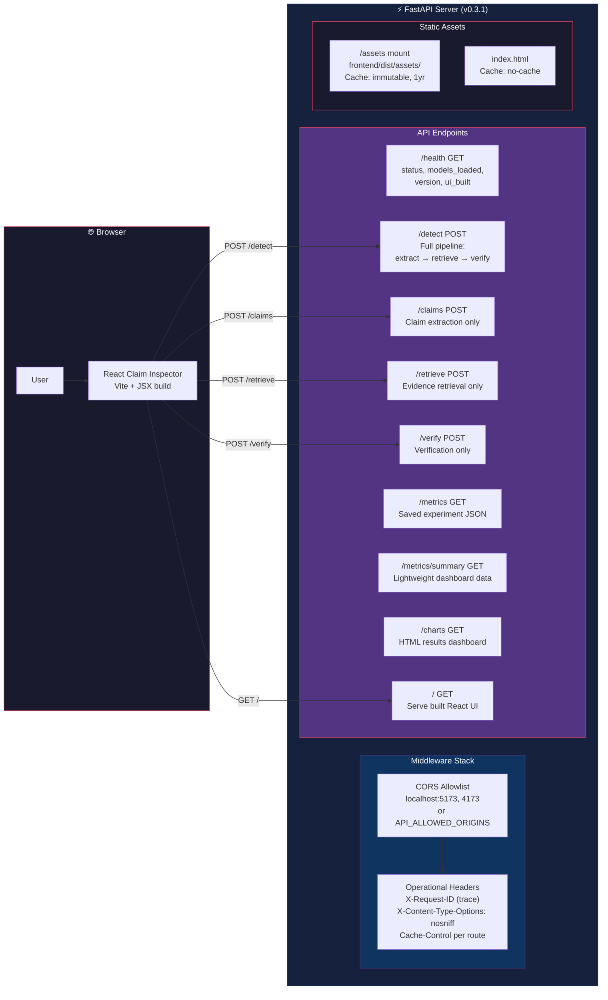
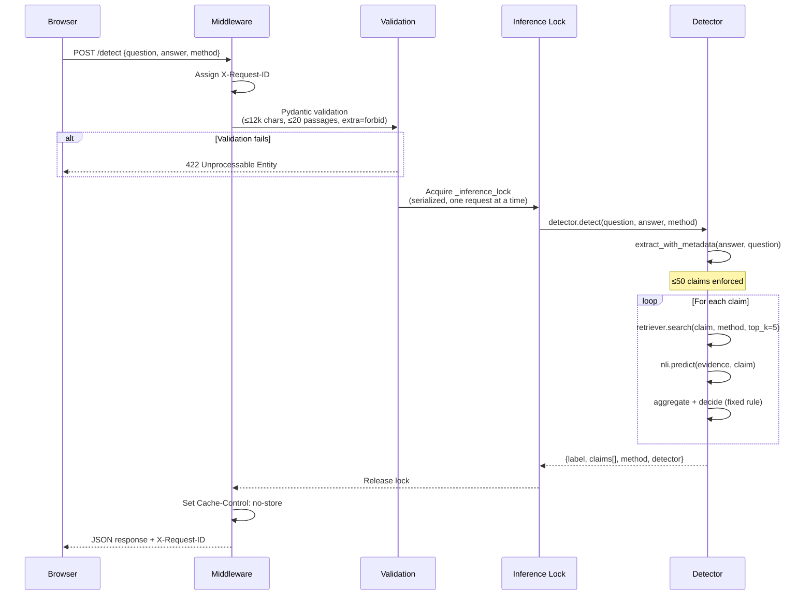
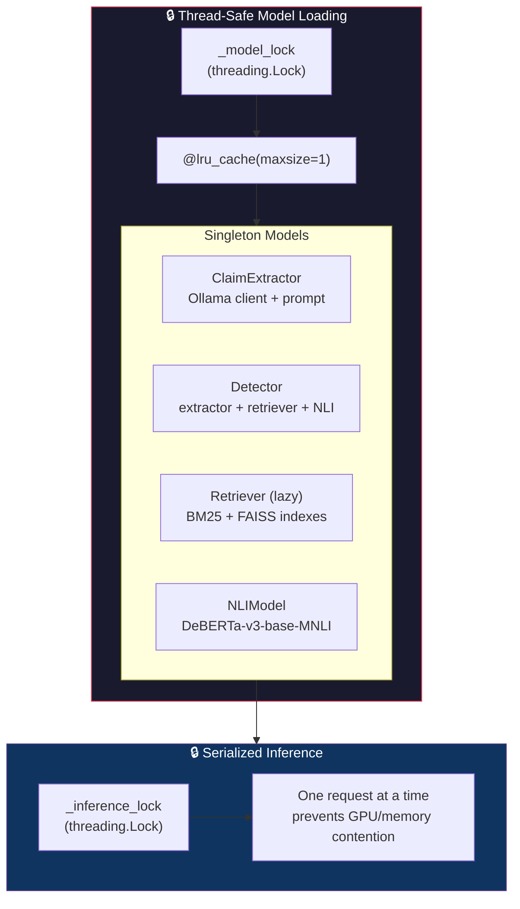

# 05 — Serving Architecture

FastAPI + React application, API routes, middleware, and operational details.

---

## Application Architecture

---

## Request Processing Flow

---

## Model Loading and Locking

---

## Request / Response Schemas

| Endpoint | Request Body | Response Shape |
|----------|-------------|----------------|
| `POST /detect` | `{answer, question?, evidence?, method, top_k}` | `{label, claims[], method, evidence_source, detector, warnings}` |
| `POST /claims` | `{answer, question?}` | `{claims[], extraction_fallback, extraction_model}` |
| `POST /retrieve` | `{claim, method, top_k}` | `{evidence[]}` |
| `POST /verify` | `{claim, evidence[]}` | `{claim, label, signals, evidence_conflict, evidence[]}` |
| `GET /health` | — | `{status, models_loaded, mode, detector, version, ui_built}` |
| `GET /metrics` | — | `{source, results{}}` |

## Operational Hardening

| Feature | Implementation |
|---------|---------------|
| Request tracing | `X-Request-ID` header (incoming or generated UUID) |
| Security headers | `X-Content-Type-Options: nosniff` on all responses |
| Cache policy | `no-store` for API routes; `immutable` for hashed assets |
| Input limits | 12k char text, 20 evidence passages, 50 claim ceiling |
| CORS | Local dev origins by default; `API_ALLOWED_ORIGINS=*` override |
| Error handling | 422 for validation, 503 for model/index unavailability |
| Graceful degradation | 503 with actionable message if UI build or models are missing |
