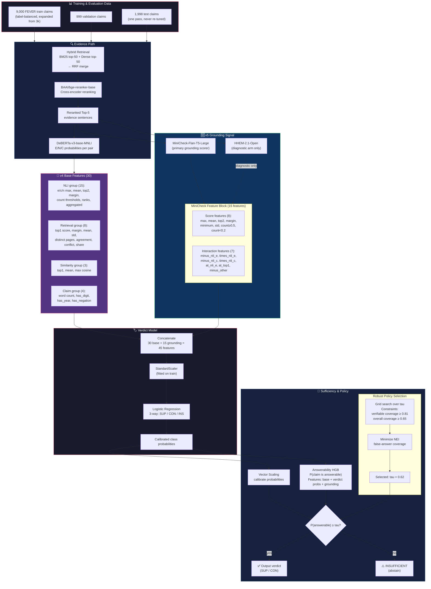
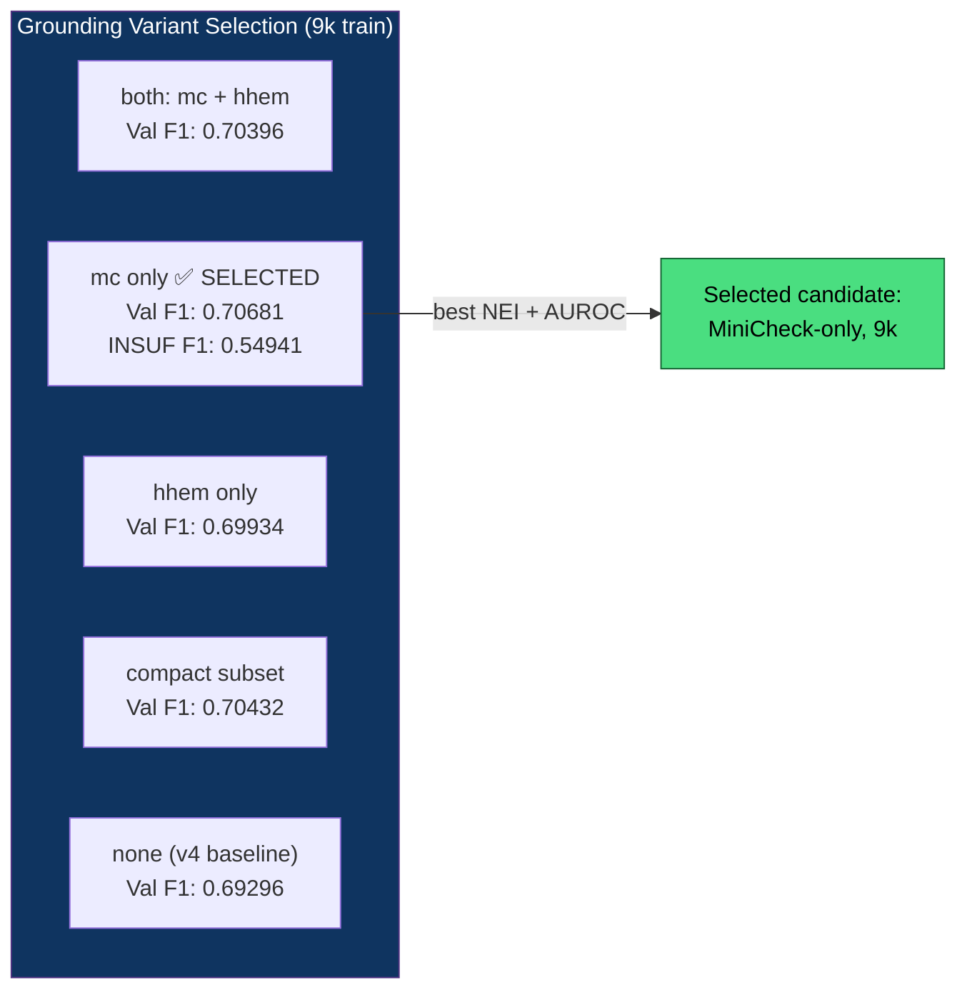
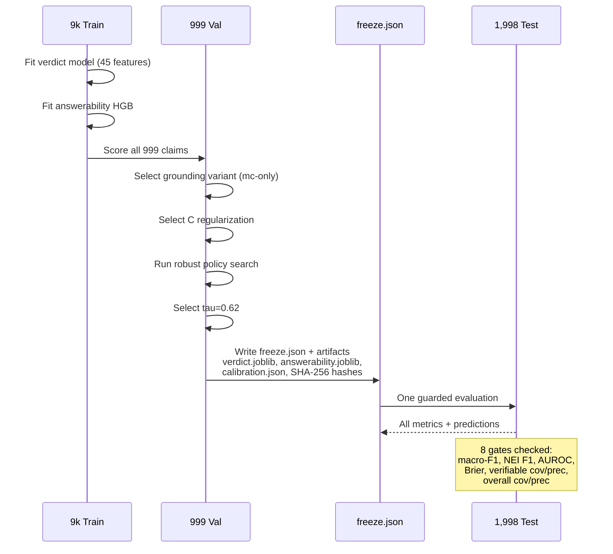

# 06 — v5 Research Architecture

v5 grounding features, answerability head, robust policy, and the complete
offline research pipeline. All eight predeclared research gates passed;
the learned model remains offline.

---

## v5 Full Research Pipeline

---

## Grounding Ablation Results

---

## v5 Evaluation Flow

---

## Eight Research Gates

| # | Gate | Threshold | Test Result | Status |
|---|------|-----------|-------------|--------|
| 1 | Final-policy macro-F1 | ≥ val−0.02 | **0.73694** | ✅ |
| 2 | INSUFFICIENT F1 | ≥ val−0.03 | **0.64483** | ✅ |
| 3 | Answerability AUROC | ≥ val−0.02 | **0.83809** | ✅ |
| 4 | Brier score | ≤ val+0.01 | **0.37519** | ✅ |
| 5 | Verifiable coverage | ≥ 0.80 | **0.81757** | ✅ |
| 6 | Verifiable precision | ≥ 0.94 | **0.95500** | ✅ |
| 7 | Overall coverage | ≥ 0.60 | **0.66266** | ✅ |
| 8 | Overall precision | ≥ 0.70 | **0.78701** | ✅ |

## Frozen Artifacts

| Artifact | Path | Purpose |
|----------|------|---------|
| Freeze manifest | `experiments/v5/freeze.json` | Hashes, configs, selected params |
| Verdict model | `experiments/v5/frozen/verdict.joblib` | Trained logistic regression |
| Answerability model | `experiments/v5/frozen/answerability.joblib` | Trained HGB classifier |
| Calibration params | `experiments/v5/frozen/calibration.json` | Vector scaling weights |
| Test metrics | `experiments/v5/test_metrics.json` | Final evaluation output |
| Test predictions | `experiments/v5/test_predictions.jsonl` | Per-claim predictions |
