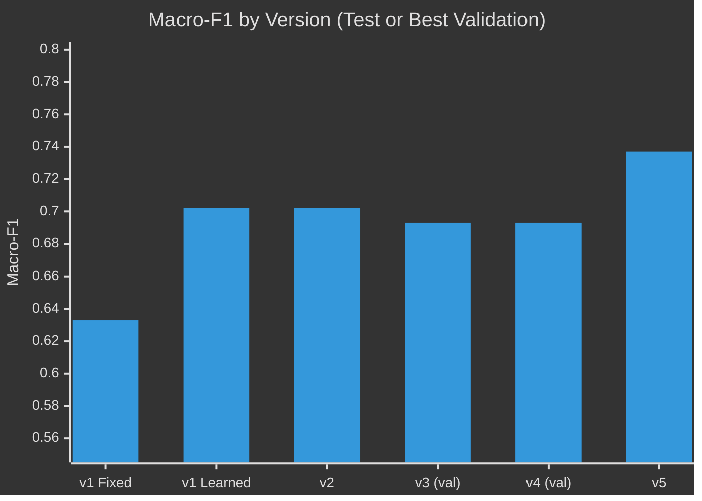
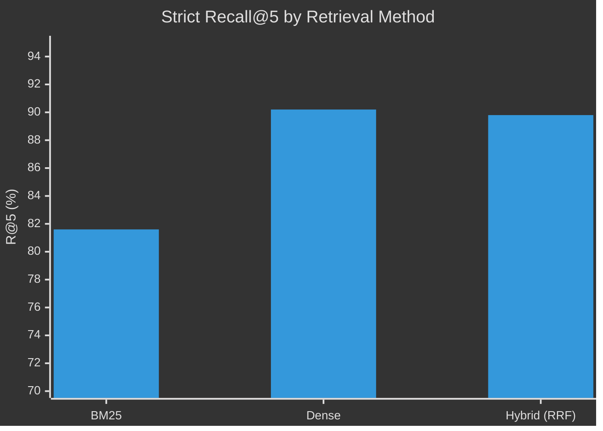
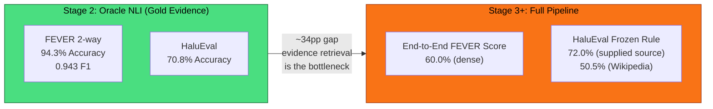
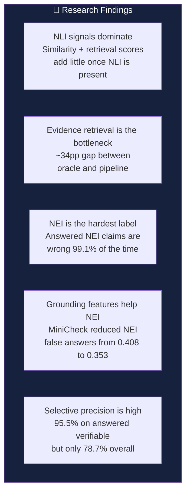

# 07 — Results Summary

Key metrics across all versions (v1–v5) with comparison tables and visual summaries.

---

## Version Comparison — Headline Metrics

---

## Complete Results Table

### v1 — Baseline

| Metric | Fixed Rule | Learned (Hybrid) | Learned (Dense) | Learned (BM25) |
|--------|-----------|-------------------|-----------------|-----------------|
| **Test macro-F1** | 0.633 | **0.702** | 0.701 | 0.682 |
| SUPPORTED F1 | — | — | — | — |
| CONTRADICTED F1 | — | — | — | — |
| INSUFFICIENT F1 | — | — | — | — |
| McNemar p-value | — | ≤ 2.4e-8 | — | — |

### v2 — Calibration + Selective Policy

| Metric | Before (v1) | After (v2) | Gate |
|--------|------------|------------|------|
| Test ECE | 0.028 | **0.023** | Improved ✅ |
| Brier | 0.39656 | 0.39725 | Worsened ❌ |
| Verifiable coverage | — | **84.6%** | — |
| Verifiable precision | — | **94.1%** | — |
| Overall precision | — | 73.6% | NEI problem |
| Flag AUROC | — | 0.734 | < 0.75 ❌ |

### v3 — Stopped Before Test

| Metric | v2 Baseline | v3 Best (Val) |
|--------|------------|---------------|
| Val Brier | 0.42303 | **0.42161** |
| NEI floor | — | 0.477 |
| Answerability AUROC | — | 0.769 |
| **Status** | — | ⛔ Stopped |

### v4 — Stopped Before Test

| Metric | v3 | v4 Best (Val) |
|--------|-----|---------------|
| Val macro-F1 | 0.693 | **0.693** |
| INSUFFICIENT F1 | — | 0.536 |
| Answerability AUROC | 0.769 | **0.787** |
| NEI coverage | 0.477 | **0.408** |
| **Status** | ⛔ | ⛔ Stopped |

### v5 — Final (One Test Pass)

| Metric | Validation | Test | Gate Threshold | Status |
|--------|-----------|------|----------------|--------|
| Final-policy macro-F1 | 0.707 | **0.737** | ≥ val−0.02 | ✅ |
| INSUFFICIENT F1 | 0.549 | **0.645** | ≥ val−0.03 | ✅ |
| Answerability AUROC | 0.820 | **0.838** | ≥ val−0.02 | ✅ |
| Brier | 0.388 | **0.375** | ≤ val+0.01 | ✅ |
| ECE | — | **0.022** | — | — |
| Verifiable coverage | 81.4% | **81.8%** | ≥ 80% | ✅ |
| Verifiable precision | 97.0% | **95.5%** | ≥ 94% | ✅ |
| Overall coverage | 66.4% | **66.3%** | ≥ 60% | ✅ |
| Overall precision | 79.5% | **78.7%** | ≥ 70% | ✅ |
| NEI false-answer cov | 36.3% | **35.3%** | — | — |
| NEI precision (answered) | — | **0.85%** | — | ⚠️ |

---

## Retrieval Performance (Stage 3)

| Method | Strict R@5 | Lenient R@5 | End-to-End FEVER Score |
|--------|-----------|-------------|----------------------|
| BM25 | 81.6% | 91.5% | 56.7% |
| Dense (BGE) | **90.2%** | **95.2%** | **60.0%** |
| Hybrid (RRF) | 89.8% | 94.8% | 59.4% |

---

## Oracle vs. Pipeline Performance

---

## HaluEval Cross-Domain Results (Frozen Rule)

| Configuration | Accuracy |
|--------------|----------|
| Claim decomposition + supplied source | **73.3%** (argmax) |
| Claim decomposition + supplied source (fixed rule) | **72.0%** |
| Whole-answer + supplied source | 58.7% (argmax) |
| Claim decomposition + Wikipedia retrieval | 50.5% |

> Claim decomposition significantly outperforms whole-answer classification.
> Wikipedia retrieval accuracy drops sharply outside the FEVER domain.

---

## Key Insights

---

## Serving vs. Research Summary

| Aspect | Served (Fixed Rule) | Best Research (v5) |
|--------|--------------------|--------------------|
| Detector | E ≥ 0.7, C ≥ 0.95 | 45-feature logistic + policy |
| Test macro-F1 | 0.633 | **0.737** |
| Features used | NLI probabilities only | NLI + retrieval + similarity + claim + grounding |
| Calibration | None | Vector scaling |
| Selective policy | None | tau=0.62 answerability gate |
| Dependencies | DeBERTa only | + MiniCheck + HGB + reranker |
| Status | ✅ Served | 🔬 Offline research only |
