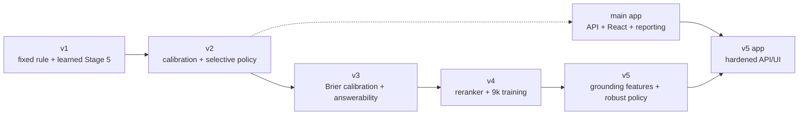
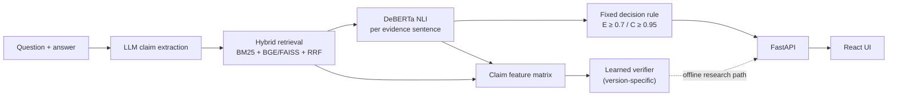

# Architecture index

This directory contains architecture notes for each research version. It replaces
the previous mixed documentation set; historical details remain in Git history and
the committed experiment artifacts.

| Version | Focus | Model status | Architecture |
|---|---|---|---|
| v1 | Claim extraction, hybrid retrieval, NLI, fixed rule, learned Stage 5 combiner | Learned model offline | [v1](architecture/v1.md) |
| v2 | Calibration, selective policy, coverage flag | Learned model offline | [v2](architecture/v2.md) |
| v3 | Brier-targeted calibration and answerability diagnostics | No test pass; offline | [v3](architecture/v3.md) |
| v4 | Cross-encoder reranking, 9k training, NEI tuning | No test pass; offline | [v4](architecture/v4.md) |
| v5 | MiniCheck/HHEM grounding, answerability policy, hardened app | One test pass; offline | [v5](architecture/v5.md) |

## Version evolution

## Shared system boundary

All versions use the same core claim-level path:

The fixed rule is the serving default. Learned, calibrated, grounded, and
answerability paths remain offline unless a separate serving decision is recorded.
v1, v2, and v5 each used one FEVER test pass for a learned candidate; v3 and v4
stopped before their test pass.
