# v1 architecture — claim-level detection baseline

**Status:** completed baseline. The fixed 0.7/0.95 rule is served; the learned
Stage 5 combiner is an offline research result.

## System diagram

```mermaid
flowchart LR
    subgraph Input
        Q["Question (optional)"]
        A["LLM answer"]
    end

    subgraph Extraction
        LLM["Ollama claim extractor<br/>gemma4:31b-cloud"]
        FB["Sentence-splitting fallback"]
        CL["Atomic claims"]
        Q --> LLM
        A --> LLM
        LLM --> CL
        LLM -. failure .-> FB --> CL
    end

    subgraph Evidence
        BM["BM25 keyword retrieval"]
        DE["BGE dense retrieval + FAISS"]
        RR["Reciprocal Rank Fusion"]
        TOP["Top-5 evidence passages"]
        CL --> BM --> RR
        CL --> DE --> RR
        RR --> TOP
    end

    subgraph Verification
        NL["DeBERTa-v3-base-MNLI<br/>entailment / neutral / contradiction"]
        SIM["BGE similarity"]
        AGG["Max-evidence aggregation"]
        TOP --> NL --> AGG
        TOP --> SIM --> AGG
    end

    subgraph Decision
        FIX["Fixed rule<br/>E >= 0.7, C >= 0.95"]
        OUT["SUPPORTED / CONTRADICTED / INSUFFICIENT"]
        AGG --> FIX --> OUT
    end

    subgraph Serving
        API["FastAPI /detect /verify /retrieve"]
        UI["React claim inspector"]
        OUT --> API --> UI
    end

    subgraph Offline["Offline research"]
        FEAT["30 claim features<br/>NLI, similarity, retrieval, claim shape"]
        LR["Logistic-regression combiner"]
        AGG --> FEAT
        TOP --> FEAT
        FEAT --> LR
        LR -. not served .-> API
    end
```



## Components

| Component | Implementation | Role |
|---|---|---|
| Claim extraction | `src/generation/claim_extraction.py` + Ollama client | Decompose answers into atomic claims; fall back to sentence splitting |
| Retrieval | `src/retrieval/bm25.py`, `dense.py`, `hybrid.py` | Retrieve evidence from the FEVER-derived Wikipedia corpus |
| NLI | `src/verification/nli.py` | Score claim/evidence pairs with DeBERTa MNLI |
| Similarity | `src/verification/similarity.py` | Secondary claim/evidence signal |
| Fixed decision | `src/verification/detector.py` | Deterministic served verdict |
| Learned combiner | `src/evaluation/fit_detector.py` | Offline 30-feature logistic model |
| API | `src/api/main.py` | FastAPI serving boundary |
| UI | `frontend/src/main.jsx` | Claim inspection and evidence presentation |

## Data and evaluation boundary

- FEVER: 3,000 train / 999 validation / 1,998 test claims, label-balanced.
- HaluEval: 2,800 train / 600 validation / 600 test examples for open-domain
  evaluation; HaluEval does not provide claim-level gold labels.
- The retrieval corpus is FEVER-derived: approximately 248k sentences.
- Learned test result: macro-F1 **0.702** (hybrid) versus **0.633** for the fixed
  rule. The learned model is not loaded by `/detect`.

## Serving boundary

```text
Browser -> React UI -> /detect -> claim extraction -> retrieval -> NLI -> fixed rule
```

There is no learned-model dependency in the serving path. `INSUFFICIENT` is a
first-class output and means the evidence does not establish the claim; it does not
prove the claim is false.
