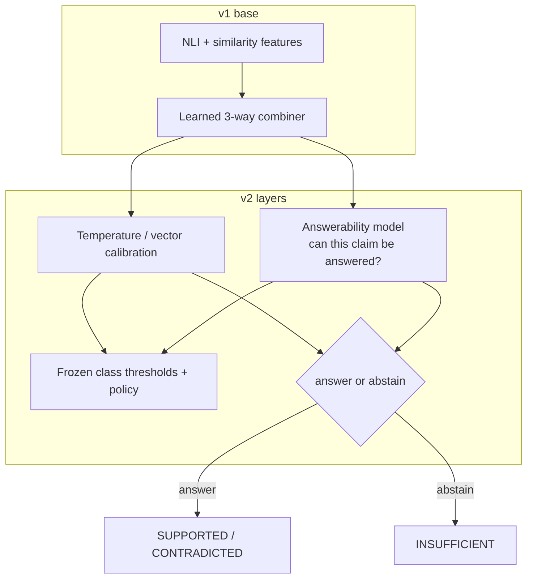
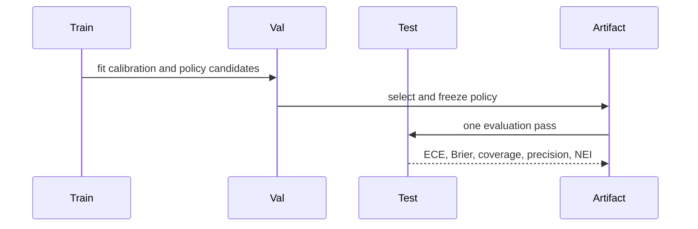

# v2 architecture — calibration and selective policy

**Status:** research complete, one test pass spent. The learned detector remains
offline. The fixed-rule API remains the serving default.

## What v2 adds

## Components

| Component | Purpose | Status |
|---|---|---|
| Calibration | Temperature scaling fitted on validation | Offline only |
| Answerability model | Predicts whether a claim can be answered | Offline only |
| Selective policy | Class thresholds plus acceptance gate | Frozen, not served |
| Coverage flag | Diagnostic for likely error/abstention | Failed test AUROC gate |
| API/UI | Fixed-rule baseline | Served |

## Evaluation flow

## Key result and serving boundary

- Test ECE improved from **0.0280 to 0.0228**.
- Brier worsened slightly: **0.39725 vs 0.39656**, so the frozen gate failed.
- Selective policy answered **84.6% of verifiable claims at 94.1% precision**.
- Overall answered precision was only **73.6%**.
- The coverage flag reached test AUROC **0.734**, below its 0.75 gate.
- The learned path stayed offline. The served path remained the fixed rule.

The important architecture lesson is that a verdict label and an operational
abstention decision are separate concepts. v2 encoded that separation but did not
make it reliable enough for promotion.
