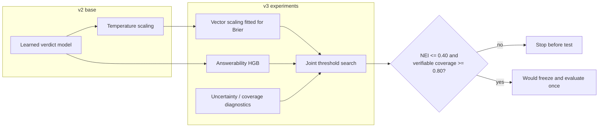
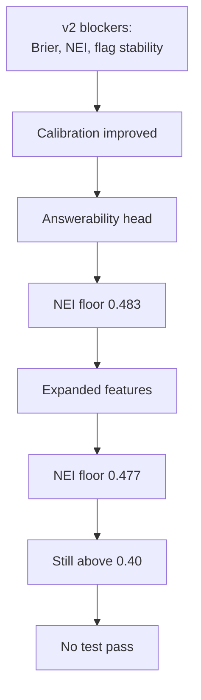

# v3 architecture — calibration and answerability diagnostics

**Status:** stopped before the test pass. The target NEI floor was not reached, so
no v3 model was promoted or served.

## Architecture

## Components

| Component | Purpose | Result |
|---|---|---|
| Vector scaling | Fit calibration to Brier instead of NLL | Val Brier 0.42161 vs 0.42303 |
| Answerability HGB | Separate sufficiency prediction head | Val AUROC 0.765 |
| Uncertainty features | NLI margin, disagreement, coverage signals | AUROC only 0.769 |
| Joint threshold search | Find a feasible NEI/coverage point | No feasible point |
| Test evaluator | One-pass held-out evaluation | Not run |

## Why it stopped

The v3 experiment produced useful calibration and diagnostic code, but the
answerability signal still could not separate insufficient evidence from verifiable
claims. The learned model remained offline.
