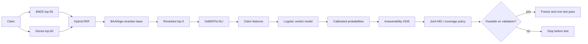
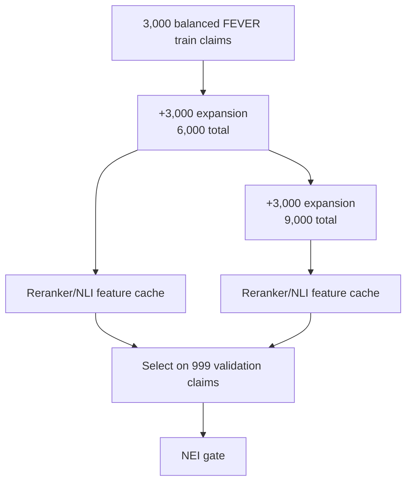

# v4 architecture — reranking and larger training sets

**Status:** stopped before the test pass. The v4 candidate improved validation
macro-F1 and NEI, but the NEI gate remained above 0.40. The learned detector stayed
offline.

## Architecture

## Components

| Component | Change from v3 | Evaluation |
|---|---|---|
| Retriever | Pretrained cross-encoder reranker over top-50 candidates | Val macro-F1 improved |
| Evidence | Top-5 reranked passages retained | Top-8 was flat |
| Training data | Expanded from 3k to 6k and 9k balanced FEVER claims | Better answerability separation |
| Answerability | HistGradientBoosting with class weighting | Val AUROC 0.794 at 9k |
| Policy | Joint threshold search over NEI and coverage | Best NEI 0.417 at 0.809 verifiable coverage |
| Serving | Fixed 0.7/0.95 rule | Unchanged |

## Data expansion

## Why it stopped

- Reranker + top-5: validation macro-F1 **0.69296**, INSUFFICIENT F1 **0.53559**.
- 9k training: answerability AUROC **0.787** (tuned **0.794**).
- Cost-sensitive tuning reached NEI **0.408** at **0.800** verifiable coverage and
  **0.768** overall precision.
- Joint search still found no feasible point; best NEI was **0.417**.
- No test pass was spent.

The v4 architecture established the feature/retrieval stack that v5 later extended
with a new grounding signal.
