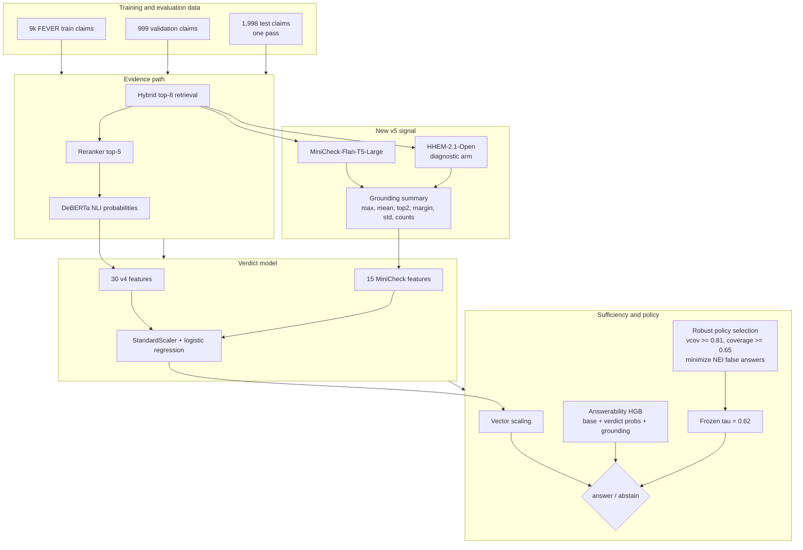
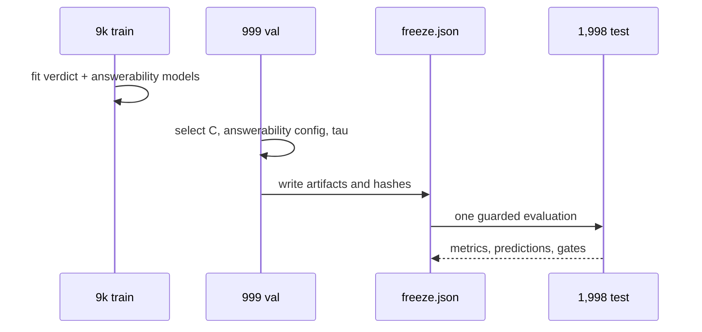
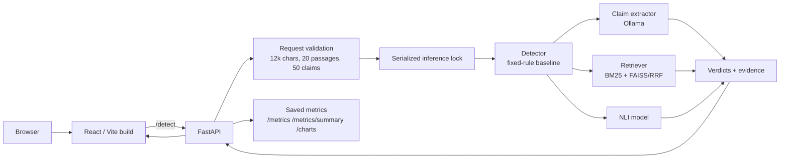

# v5 architecture — grounding, sufficiency, and the hardened app

**Status:** research complete. One FEVER test pass was spent; all eight predeclared
research gates passed. The learned path remains offline. The fixed 0.7/0.95 rule is
the served detector.

## Research architecture

## Component contract

| Layer | Input | Output | Status |
|---|---|---|---|
| Claim extraction | Question + answer | Atomic claims; sentence fallback | Served |
| Hybrid retrieval | Claim | BM25 + dense candidates fused by RRF | Served |
| Reranker | Candidates | Top-5 evidence | Offline v4/v5 research only; app uses the fixed path |
| NLI | Claim + evidence | E/N/C probabilities | Served |
| Fixed rule | Aggregated NLI | 3-way label | Served |
| MiniCheck features | Top evidence + claim | 15 grounding features | Offline v5 only |
| Verdict model | 45 features | 3-way probabilities | Offline v5 only |
| Answerability HGB | Base features + verdict probabilities + grounding | P(answerable) | Offline v5 only |
| Robust policy | Calibrated verdict + answerability | Answer or INSUFFICIENT | Offline v5 only |

## Evaluation flow

The durable artifacts are:

- `experiments/v5/freeze.json`
- `experiments/v5/frozen/verdict.joblib`
- `experiments/v5/frozen/answerability.joblib`
- `experiments/v5/frozen/calibration.json`
- `experiments/v5/grounding_ablation_3000.json`
- `experiments/v5/grounding_ablation_9000.json`
- `experiments/v5/test_metrics.json`
- `experiments/v5/test_predictions.jsonl`

## Validation and test result

Validation at `tau=0.62`:

| Metric | Value |
|---|---:|
| Raw macro-F1 | 0.70681 |
| INSUFFICIENT F1 | 0.54941 |
| Answerability AUROC | 0.81957 |
| Brier | 0.38753 |
| Overall coverage / precision | 0.66366 / 0.79487 |
| Verifiable coverage / precision | 0.81381 / 0.97048 |
| NEI false-answer coverage | 0.36336 |

Test, one pass:

| Metric | Value |
|---|---:|
| Final-policy macro-F1 | 0.73694 |
| INSUFFICIENT F1 | 0.64483 |
| Answerability AUROC | 0.83809 |
| Brier / ECE | 0.37519 / 0.02179 |
| Overall coverage / precision | 0.66266 / 0.78701 |
| Verifiable coverage / precision | 0.81757 / 0.95500 |
| NEI false-answer coverage | 0.35285 |
| NEI precision when answered | 0.00851 |

All eight research gates passed. NEI is reduced, not solved: the policy abstains on
64.71% of NEI claims, and the NEI claims it answers are almost always wrong.

## Application and serving architecture

Operational hardening present in the served app:

- request IDs and `X-Content-Type-Options: nosniff`;
- local-origin CORS allowlist via `API_ALLOWED_ORIGINS`;
- `Cache-Control: no-store` for sensitive API responses;
- 240-second frontend timeout and explicit cancel;
- safe JSON and FastAPI validation-error formatting;
- `/health` reports version and whether the UI build exists;
- `/` serves the built UI or returns an actionable 503.

## Why v5 is not served

The v5 candidate clears the research gates, but the serving decision is separate:

- overall answered precision is **78.7%**, not 90%+;
- verifiable precision is **95.5%** only on the **81.8%** answered subset;
- answered NEI precision is **0.85%**;
- inference latency and cost were not promoted through a serving gate.

The fixed rule remains the safe default. v5 remains the best offline research
version and must not be presented as the demo's accuracy.

Results: [`../results/v5.md`](../results/v5.md).
